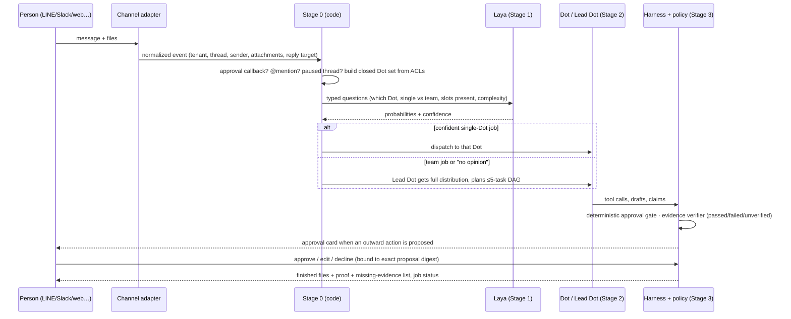

# KatWork: the self-hosted AI team office — design spec

| | |
|---|---|
| Date | 2026-10-22 |
| Status | Approved for the alpha (2026-10-22) |
| Maintainer | @Minniesse |
| Milestone | Public alpha by **2027-01-31** |
| Inputs | Design interviews and internal research (not published) |

## 1. Summary

KatWork lets anyone in an organization hire a team of named AI coworkers ("Dots") that do real office work on their own isolated computers and hand back **finished files with proof**. People talk to the team from LINE, Slack, Teams, RustChat/Mattermost, Telegram, Discord, WhatsApp, the web, desktop or mobile, and they watch the work in a cute 3D office and a live graph of every agent call. Anything risky waits for a human to approve. The whole system runs **on the organization's own servers**, with the model providers you choose (qualified hosted APIs or local models), in English and Thai.

**Positioning:** KatWork is *the self-hosted AI team office*, for organizations of any size. It turns folders of everyday files into finished, source-cited documents through a persistent team of named coworkers, with human approvals. It differs from:
- hosted coworker products such as OpenAI ChatGPT Dots, which run in the vendor's cloud;
- open-source coworker templates such as CopilotKit OpenDots, which self-host but depend on CopilotKit Intelligence (a vendor service, hosted or licensed) for conversations, approve only some actions, and keep no evidence;
- general AI assistants, which help draft but don't deliver template-exact files with claim-level proof and approvals.


### 1.1 Goals for the alpha (2027-01-31)

1. A self-hosted install that starts with `docker compose up` on one Linux server.
2. A default team (Lead, Researcher, Writer, Analyst, Scheduler, Reviewer) that people can rename, restyle and extend.
3. Messages from every listed channel, routed to one Dot or to a planned team job. The lead Dot routes while Laya runs in shadow mode; Laya routes in milliseconds once it passes its calibration gate (§6.3).
4. Real work on real computers: files read and written, web research, documents produced in the customer's template.
5. Proof on every deliverable: each claim *passed*, *failed* or *unverified*, plus a missing-evidence list.
6. Deterministic approvals for anything outward or destructive.
7. Four views: 3D office, live agent graph, chat, and a tasks-and-files board.
8. Six showcase templates (§8): four chosen, plus two from the use-case research.
9. Login with password reset and demo accounts, so a live demo never depends on an external login.

### 1.2 Non-goals for the alpha

- KatWork's own agentOS; the alpha uses rivet agentOS (§14 lists what the in-house agentOS must provide).
- A VM per Dot. Per-Dot microVMs come with the in-house agentOS.
- Voice and video calls.
- Federation between installs. It moves to the first post-alpha release (§12).
- Native Linux binaries inside a Dot's computer. Native tools run as KatWork Rust tools or pinned containers; native Linux comes with the in-house agentOS (§9).
- Live Dot control of Craft apps. The alpha shows revision previews; live control waits for a bridge in the Craft web builds (§9.1).
- High availability or multi-host scheduling.
- A hosted cloud offering. The paid cloud comes after the alpha (§16).
- Unofficial WhatsApp Web, and any GPL or AGPL code in the core.

## 2. Decisions

| Area | Decision |
|---|---|
| Product shape | A general AI team for any office work. Templates showcase jobs; they do not limit them. |
| Team model | Persistent "Dots", like OpenAI ChatGPT Dots and CopilotKit OpenDots. Each has a name, role, personality, memory, its own computer, and a tool allowlist. |
| Edge | A team anyone can build · finished work with proof · a safe computer per agent · English and Thai together. |
| Beachheads | University report offices (SAR and annual reports) and listed-company One Report sustainability teams. KatWork itself stays horizontal. |
| Core language | Rust for all KatWork code. Inside their sandbox, agents may run JavaScript, Python (Pyodide) and WASM; native tools run as KatWork Rust tools or pinned containers (§9). |
| UI | React and Vite in TypeScript, served by the Rust server. Tauri for desktop, Capacitor for mobile. |
| Platforms | Web, desktop and mobile, plus connectors for LINE, Slack, Teams, RustChat/Mattermost, Telegram, Discord and WhatsApp (official Cloud API). |
| Hosting | Self-hosted from day one, packaged with Docker Compose. An optional Caddy profile provides HTTPS, and a documented tunnel recipe gives webhook channels a public URL behind NAT. A KatWork-run relay is decided later, with the Cloud plan (§16). |
| Licence | Open-core under Apache-2.0. No GPL or AGPL code in the core. |
| Models | The model providers the admin chooses, from qualified hosted APIs or local models (§11). Default to the strongest API model, with a local model for sensitive data. |
| Decision layer | Laya, multilingual checkpoint only, running inside Rust (ONNX via `ort`, or `laya-rust`), with separate calibration per language. Used for intake routing only, in shadow mode until it passes the 50-case calibration gate; the lead Dot routes until then (§6.3). |
| Routing | A 4-stage routing design (§6) combined with the four JEVIS layers (§5). |
| Sandbox | rivet agentOS now, plus one Chromium container per Dot, driven by the Rust browser supervisor. Later, an in-house agentOS replaces the existing one; candidates are under evaluation (§14). |
| Office apps | The storytold Craft apps where they pass our gates (§9). docx-rs, umya-spreadsheet, pdf-extract, lopdf, Typst and OAR-OCR are the dependable base. |
| Memory | Built in: Postgres, Qdrant and Tantivy with nlpO3, per Dot and per team. Plus a RustShare connector. |
| Views | 3D office (react-three-fiber with Kenney and Quaternius CC0 assets), live agent graph, chat, tasks-and-files board. |
| Federation | After the alpha (founder decision, 2026-10-22): a selective fork of reason-network with our own identity and relay (§12). |
| Revenue | Free core, paid Enterprise edition, and later a paid hosted cloud. |
| Name | KatWork, "the self-hosted AI team office". Repo `Minniesse/katwork`. |
| Team | A solo maintainer builds the app with AI coding agents orchestrated by Orca. |
| Development loop | Approved spec, then small GitHub Issues labelled `ready-for-agent`, then Orca workers in worktrees with TDD. The model that didn't write a PR reviews it (§19.1), the founder approves every PR, CI must be green, and there is a weekly demo. |
| Tracking | GitHub Issues for engineering; the Notion KatWork board for phases. |

## 3. Users and their jobs

- **Who uses it:** non-technical staff who own recurring document work. For example: planning and QA officers, sustainability and IR teams, hospital quality staff, school administrators, agency account managers and NGO program staff.
- **The job that recurs everywhere:** turn a folder of evidence into a finished, cited document by a deadline. Accuracy and confidentiality are the top fears, and "AI drafts, a human checks" is already a trusted pattern.
- **The trust line in the product copy:** "AI ร่างและตรวจสอบเบื้องต้น — คุณตรวจทานและอนุมัติ" ("AI drafts and does a first check — you review and approve").
- **Words to use:** "ผู้ช่วย AI" (AI assistant), "ทีม" (team), "ห้องทำงานทีมผู้ช่วย AI" (AI-assistant team office).
- **What to call the coworkers:** "Dots", in every language and in user-facing copy (founder decision, 2026-10-22). "ผู้ช่วย AI" describes what a Dot is.
- **Word to avoid:** "พนักงาน AI" (AI employee), which carries a layoff connotation.

## 4. Domain model

| Concept | Meaning |
|---|---|
| **Workspace** | One self-hosted install's tenant: an organization or unit. It owns members, model settings, budgets, connectors and federation links. An admin can pause all of its Dots. |
| **Space** | A shared area inside a workspace, such as a faculty office or an ESG team. It holds files, pages, memory and the Dots granted to work there. |
| **Dot** | A persistent AI coworker with a name, role, personality, instructions, memory, tool allowlist, model tier, autonomy level and its own **Computer**. Created from a role template or "hired" with a short form. It can be granted to several Spaces, with one default Space for its output. Its status is active or paused. |
| **Team** | A lead Dot plus specialists. The team saved on the server **decides who does the work**; it is not decoration. |
| **Thread** | A conversation between people and Dots in any channel. Each thread is mapped to one KatWork thread id. |
| **Job** | One request, from intake to final status. It owns the plan, the runs, the evidence and the verdict. |
| **Task** | A bounded piece of a job assigned to one Dot: inputs, acceptance conditions, a lease and retry limits. A job's tasks form a DAG of at most 5 tasks and 3 levels. A Dot runs one task at a time by default (admin-set `max_concurrency`); parallel work inside one Dot waits for Computer fork (§14 #3). |
| **Run** | One Dot executing one task: steps, tool calls, tokens, cost and an event stream. |
| **Computer** | A Dot's sandbox: an agentOS workspace, an optional browser profile, and app access (§9). |
| **Artifact** | A versioned output file or page. Originals are immutable and every new version is written atomically. |
| **Evidence** | A source span (file, page, cell, URL, retrieval time, content hash) linked to a claim. |
| **Claim** | A statement in an artifact, such as a number, date or fact, with status *passed*, *failed* or *unverified*. |
| **Proposal** | An exact pending side effect (action, parameters, target, digest) waiting for approval. It is invalid if anything changes. |
| **Template** | A showcase job definition: the output format and template file, the team, the questions it asks, and its **acceptance contract** (§7.3). |
| **Peer** | Another KatWork install linked through federation (§12). |

**Job statuses** (from JEVIS):

| Status | Meaning |
|---|---|
| `accepted` | The template's preset acceptance contract passed against the current artifact version. |
| `ready` | A result exists, but there was no independent acceptance, for example because the checks were produced by the same Dot. |
| `answered` | A read-only answer. |
| `needs_input` | Waiting on a person. Final in the alpha: the person's answer starts a follow-up job linked by `parent_job_id`. Resuming the same job, together with approval resume, comes with the gates sub-project (§19; `docs/adr/0002-needs-input-is-final-in-sp1.md`). |
| `stopped` | A rule fired; the job carries a named reason and a way to carry on. |

`cancelled` and `error` are set by the harness, outside the policy.

## 5. Architecture

### 5.1 Four layers

KatWork follows the JEVIS layering: **the decision model advises, the harness executes and observes, and the policy decides.** No layer can skip the next one.

| Layer | In KatWork | Rules |
|---|---|---|
| Executor (replaceable) | A Dot's agent loop: KatWork's own guarded loop over Rig model clients, its model, and its computer (`docs/adr/0001-katwork-owns-the-agent-loop.md`) | Never decides how a job ends. Its "done" is only a claim. |
| Harness | The Rust core: scheduler, task leases, document snapshots, registered checks, approval host, evidence verifier, event log | Owns execution and evidence. Runs checks as argv arrays, never through a shell. Snapshots artifacts before and after each check. |
| Decision model | Laya, multilingual, inside Rust | Answers typed questions over closed option sets that code builds. Writes no text and no code. Its uncertainty narrows permissions; it never widens them. |
| Policy | A thresholds table plus one pure Rust function that turns recorded facts into the next action or a verdict | No I/O, clock or model calls. It can be replayed from the log. |

### 5.2 Services (Docker Compose)

```
┌──────────────────────── katwork (one Linux host, docker compose) ─────────────────────────┐
│ katwork-core (Rust)                                                                         │
│   axum API + AG-UI SSE · serves React/Vite build                                            │
│   scheduler (Tokio, task leases, retries) · policy fn · approval host · evidence verifier   │
│   decision worker (Laya multilingual ONNX via ort, warm, bounded concurrency)               │
│   model gateway (Rig providers; capability + data-residency rules; quotas)                  │
│   channel adapters (LINE, Slack, Teams, RustChat/Mattermost, Telegram, Discord, WhatsApp)   │
│   federation bridge, after the alpha (reason-network fork, OIDC identity, own relay)        │
│ dot-workers (Rust) ── agentOS sidecars (one workspace per Dot) ── document tools            │
│ browser-supervisor (Rust, chromiumoxide) ── chromium per Dot (a profile per person)         │
│ craft-apps (web builds / MCP servers that pass the gates, §9)                               │
│ postgres (jobs, tasks, proposals, events, memory metadata) · qdrant (vectors)               │
│ artifact volume (local or S3-compatible) · optional: mistral.rs local LLM                   │
└─────────────────────────────────────────────────────────────────────────────────────────────┘
```

Vendor picks (one primary pick per role):
- **Core:** Rig (model provider clients only) · Tokio · Axum · SQLx on PostgreSQL · rmcp (MCP) · a2a-rs (external peers only) · openidconnect (federation identity in sub-project 8, after the alpha; SSO is Enterprise, §16).
- **Sandbox and browser:** rivet agentOS Rust client and sidecar · chromiumoxide.
- **Documents:** docx-rs · umya-spreadsheet · pdf-extract · lopdf · Typst · OAR-OCR.
- **Search and Thai text:** Tantivy with nlpO3 · Qdrant · ICU4X.
- **Inference:** ort (Laya) · mistral.rs (optional local LLM).
- **Front end:** AG-UI protocol 1.0 events as KatWork serde types with conformance fixtures; the community Rust crates are not used (`docs/adr/0003-own-ag-ui-event-types.md`). Our own React UI, not CopilotKit Intelligence.
- **Shells and art:** Tauri · Capacitor · react-three-fiber with drei · Kenney Furniture Kit · Quaternius Universal Base Characters.

### 5.3 What must stay in-house

These cannot be bought or vendored:
- Durable team orchestration (leases, retries, restart recovery without repeating side effects).
- The approval host.
- Credential and computer isolation.
- The evidence model and the citation verifier.
- Safe document editing (immutable originals, atomic versions, read-back validation).
- The accessible office view.
- Local-model qualification.
- Decision calibration.
- Federation trust.

## 6. From message to finished work

### 6.1 Flow



### 6.2 Stage 0: code (under 1 ms)

- Approval callbacks go to the approval host.
- A message in a thread whose last job ended `needs_input` starts a follow-up job linked by `parent_job_id`. Resuming the waiting task comes with the gates sub-project (§19).
- `@mentions`, in English or Thai (`@นักวิจัย`, "researcher"), go straight to that Dot if the person may use it.
- Code builds the **closed set of eligible Dots** from Space ACLs, so the model can never pick a Dot the person may not use.
- Thai script detection picks the language calibration table.

### 6.3 Stage 1: Laya, intake only

One forward pass asks:
- `target_dot`: a choice over the closed set, plus `none_suitable`.
- `execution_mode`: single Dot vs team.
- Narrow slot questions about the text: does it mention a file that isn't attached? Is a recipient or date missing?
- `complexity_tier`: picks the model tier.

Rules:
- **Thresholds are set per language** after temperature fitting on labelled data, with a 10× resampling check. They are expressed as `p_max` plus a margin of at least 0.15 between the top two options.
- Low confidence means "no opinion" and goes to the lead Dot. A missing answer is never agreement.
- **Uncertainty narrows permissions.** If the request's mode (produce or change files / read-only / answer) is uncertain, the job runs read-only or asks the user.
- **Shadow mode first.** In the alpha, Laya logs each decision without applying it, and the lead Dot routes. Each language is promoted only after it passes the 50-case calibration gate (§15).

What early evaluation suggests (to be confirmed by the calibration work in §15):
- Routing accuracy was similar in English and Thai.
- English confidence was badly calibrated.
- Approval and numeric-proof questions failed, so they are not Laya's job.

### 6.4 Stage 2: fast path or team

- **Single Dot.** The share is assumed to be about 70–80% of messages, unmeasured; it is measured on the calibration set (§15). The task goes straight to that specialist without waking the lead.
- **Team.**
  - The lead Dot gets the authorized agent cards, Laya's full distribution, each Dot's availability, and the cost per model tier.
  - It returns a constrained JSON DAG: at most 5 subtasks and 3 levels.
  - Rust validates the plan: every assignee is in the closed set and the graph is acyclic. Only then are task leases created.
  - Dots hand work to each other through typed `DotEnvelope` messages on the Postgres-backed bus.
- **Clarifying.** Up to three related questions in one card or message, each with a recommended option and free text (LINE quick-reply or Slack buttons where available). Work continues only on an explicit answer or an explicit "use the recommended options". No answer leaves the job `needs_input` with the questions saved; a timeout never picks defaults. The requester or a Space admin may answer.
- **Plan-item closure.** Each plan item gets its own "is this shown closed by the work and the checks?" question. Open items go to the next attempt **by name**. They also drive the live graph and the office view. In the alpha, closure is decided by a lead-Dot structured check plus the registered checks, never by Laya.

### 6.5 Stage 3: deterministic gates

- **Approval gate (Rust, at the tool boundary).**
  - The gate classifies each action from the tool's declared action type and the target or recipient: read, navigate, workspace read, draft, workspace write, exec, credential use, destructive, and outward (send, publish, pay, share, external API). Only read is ungoverned. Laya never decides this.
  - Outward and destructive actions become a **Proposal** with exact parameters and a digest.
  - The requester or a Space admin approves that exact proposal from any channel or the web. Channel approvals count only from accounts linked to a KatWork user. Every approve, edit and decline records who, which channel and when. Changed parameters need a new approval.
  - Permissions are re-checked immediately before the side effect.
  - A **reply** goes to the thread the request came from; the harness fills the target and it is not gated. A **send** is any other target or a proactive post; it is outward and becomes a Proposal.
- **Evidence verifier (Rust).**
  - It extracts every number, date and named figure from the artifact and normalizes them: Thai and Arabic numerals, พัน and ล้าน (thousand and million), percentages, Buddhist-Era years.
  - It checks arithmetic and rounding against the cited source span.
  - Each claim is recorded as *passed*, *failed* or *unverified*. Unverified claims make up the **missing-evidence list**.
  - A "done" from a Dot is a claim, never evidence.
- **Acceptance.**
  - A job is `accepted` only when the template's contract passes on the current artifact version.
  - The contract and its checks are hashed when the job starts. If they change during the job, acceptance is forbidden.
  - Checks written by the same Dot that produced the work cap the job at `ready`.

### 6.6 Limits and carry-on

- Each run has a step, token and wall-clock budget; each model or tool call's timeout is the smaller of its own and the run's remaining time.
- Repairs per task are capped at 2.
- Wall-clock limits apply per task and per job.
- Loop detection stops repeats.
- Each tool call has a timeout.
- Every stop names its reason and offers a next step: run all cheap checks, ask the user, hand to the lead, save the draft with its evidence report, retry, or restart the job.
- An admin can **pause all Dots**: running work ends `stopped/workspace_paused`, queued and scheduled work waits, and channels reply that the team is paused.

## 7. Proof, approvals and templates

### 7.1 Evidence model

- **Source spans:** each source span stores the file id and version, the page, sheet or cell, or the URL and retrieval time, a content hash and the exact text.
- **Claims:** each claim in an artifact links to one or more spans.
- **Reports:** the report a person reads is generated by code from these records. The model never invents the explanation.

### 7.2 Approval experience

- **Where cards appear:** in the channel the person is using (LINE Flex message, Slack Block Kit, Teams card, Telegram and Discord buttons) and in the web approval queue.
- **What a card shows:** the exact action, the target, and a preview or diff. Options are Approve, Edit or Decline.
- **Audit:** every decision is logged. Enterprise adds policy rules on top, for example two approvers for external sends.

### 7.3 Templates and acceptance contracts

A template defines:
- the output type (DOCX, XLSX, PDF or page; PPTX from Phase 2) and the customer's own template file;
- the default team and its roles;
- the questions it asks at the start;
- the evidence rules, for example that every number in section 2 must cite a sheet and cell;
- the **acceptance contract**: the registered checks that must pass (template placeholders filled, required sections present, every numeric claim passed or listed as missing, a successful read-back and render).

Templates are data. New ones need no code changes.

## 8. Alpha templates

| Template | Output | Team | Acceptance contract highlights |
|---|---|---|---|
| University SAR / annual performance report | DOCX in the office's template; criteria-mapped evidence table | Lead, Researcher (collects evidence), Analyst (KPI tables), Writer, Reviewer | Every indicator section present; every number cited to a cell or page; missing-evidence list mapped to the institution's QA framework (for example CUPT QA, AUN-QA, EdPEx; CHE QA where used) |
| One Report sustainability section (56-1) | DOCX in Thai and English, with an XLSX data appendix | Lead, Analyst (reconciles branch data), Writer, Reviewer | Totals reconcile with source sheets; year-over-year changes recomputed; conflicting figures flagged; bilingual sections in parity |
| Meeting minutes | DOCX formal minutes plus an action-item list. Input: typed notes, DOCX or a supplied transcript; no audio in the alpha | Writer, Scheduler (owners and dates), Reviewer | Every action item has an owner and date or is flagged; decisions quoted from the source |
| Research brief | DOCX brief with cited sources (PPTX after the alpha) | Researcher, Analyst, Writer, Reviewer | Every factual claim links to a saved web or file span; no uncited figures |
| Monthly management / board commentary pack (added after early evaluation) | DOCX bilingual commentary plus an XLSX variance and lineage table. PPTX deck comes after the alpha | Lead, Analyst (variance bridge, cross-file reconciliation), Researcher (explains the drivers), Writer, Reviewer | Every figure is identical across all outputs because they draw on the same verified fact ids; cross-file conflicts become an approval card; actual vs budget, month-over-month and year-over-year recomputed in code |
| Hospital HA Standard v6 self-assessment (added after early evaluation): a **rubric pack on the SAR engine, no code** | DOCX in the HA official form (`FM-ACD-088-01`) | SAR team | As SAR, plus a **patient-identifier (HN) and personal-data redaction check** in the Reviewer before any approval |

An early evaluation scored candidate office use cases. These two were added because:
- The monthly pack runs **every month** in every company, while SAR and One Report are yearly.
- HA self-assessment has the same structure as a university SAR. Together they reuse the alpha engine for about 3–5 extra days of work.

The roadmap after the alpha, from the same early evaluation:

| Phase | Timing | Use cases | New capability |
|---|---|---|---|
| Phase 2 | Feb–Apr 2027 | Procurement TOR and reference-price matrix · grant proposal, NRIIS budget and pitch slides · audit PBC chasing and tie-out · school e-SAR · NGO donor report · ITA disclosure binder · survey synthesis | PPTX output, Thai OCR at scale |
| Phase 3 | May–Aug 2027 | Tender response · bilingual policy translation with tracked changes · agency client report · ISO management review · training-course kit · BOI pack · official memo factory · competitor digest · M&A diligence matrix | Tracked-changes engine, scheduled browser research |
| Phase 4 | Sep–Dec 2027 | Onboarding pack · events team · academic promotion dossier · bank-statement-to-tax pack · LINE OA replies with insights · PDPA RoPA · content calendar with visuals and video · feasibility memo · safeguarding portfolio · crisis fact pack | Creative Dot: image (later video) generation through the model gateway, opt-in, with cost caps; Craft apps for editing |

## 9. Dot computers and office apps

The alpha computer for each Dot has these parts:

- **agentOS workspace.**
  - Files: the original inputs (read-only) and the drafts (versioned).
  - Commands through the agentOS exec API only, as a per-Dot capability that is off by default, bounded, gated like any tool call and recorded.
  - Python through Pyodide, for light data work.
  - JavaScript, Python (Pyodide) and WASM only; native binaries are rejected. Native work (OCR, Typst, Chromium, Craft sidecars) runs as KatWork Rust tools or pinned containers outside agentOS. Native Linux tools come with the in-house agentOS (founder decision, 2026-10-22).
- **Browser profile.** A separate Chromium container per Dot, driven over CDP by the Rust browser supervisor. Each Dot keeps one profile per person by default; an admin can mark shared team logins that anyone with access to the Space may use. Profiles and downloads persist, and **a person can take over** from the office view. Signing in during take-over is allowed and audited.
- **Document tools as Rust MCP tools.**
  - docx-rs fills templates and makes structured edits.
  - umya-spreadsheet edits existing workbooks without silently recalculating them.
  - pdf-extract extracts digital PDFs, keeping page and span provenance.
  - OAR-OCR reads scanned Thai documents.
  - Typst produces new cited PDF reports.
  - lopdf handles constrained PDF edits.
- **Network rules.** Egress is limited per Dot. Secrets stay outside the sandbox, and no control-plane files or provider keys are mounted.

### 9.1 Craft apps as visible office apps

**Policy.** A small, qualified set of Craft apps gives Dots visible office tools. **KatWork's document pipeline stays authoritative**: the Rust libraries above produce every deliverable. The root code of all 13 Craft repos is dual MIT OR Apache-2.0, and KatWork uses the Apache-2.0 branch; dependency exceptions are listed per app. All have browser builds, FilmCraft included. They are only 13–22 days old, though, so every operation is gated.

**The apps are displayed inside KatWork (founder decision).** Craft apps run as **web builds** inside KatWork. Live Dot control needs a `postMessage` bridge that the Craft web builds lack, so the alpha ships revision preview and person editing; KatWork proposes the bridge upstream in parallel, and WordCraft and PhotoCraft are viewers until it lands (founder decision, 2026-10-22):
- In the 3D office, each Dot's monitor shows a labelled preview of its current revision (PdfCraft, WordCraft, PhotoCraft…), and the live app once the bridge lands.
- Clicking the Dot opens a full-size **Computer panel** with the same web app on that revision. Where editing is enabled, a person edits through the control lease.
- On mobile, the panel opens full-screen, read-only by default.
- Each embedded app is served from its own sandboxed origin per Dot session (below), so it can't reach KatWork's authenticated origin.

**Alpha set, in qualification order:**

| Order | App | Role in the alpha |
|---|---|---|
| 1 | **PdfCraft** | Opens source PDFs and generated report PDFs in the office, so people can see a Dot reading and checking citations. It has explicit Thai shaping. Its OCR cannot read Thai, so Thai scans use OAR-OCR. |
| 2 | **PhotoCraft** | Narrow image operations through its sidecar: crop, resize, composite and format conversion, for report figures and cover images. Starts with PNG and JPEG. The web build is a viewer until the bridge lands; then it becomes a workbench where a person can continue the work. |
| 3 | **WordCraft** | A viewer in the alpha: inspects drafts and previews the meeting-minutes template. Once the bridge lands, editing is enabled only for templates that pass independent DOCX round-trip tests. |
| Later | **GridCraft** | Stays behind umya-spreadsheet. Loading a file recalculates formulas, which must never replace the saved source values. |
| Deferred | Other nine apps | DeckCraft for PPTX (Phase 2), the creative apps (Phase 4), and the rest. |

**How Dots drive them:**
- **Sidecar CLI or MCP first** for bounded automation. These tools run as pinned images, isolated per tenant, exposed as a small allowlist of operations (inspect, render page, propose image edit, save draft).
- **The browser build** when a person needs to see or edit the current revision. It runs from a separate origin per Dot or session, with a minimal host page that receives only a scoped artifact capability.
- **One active editor at a time.** A control lease belongs to either the Dot or the person. Takeover pauses automation, a save creates a new revision, and stale writes are rejected.
- **The office monitor shows labelled previews** of the current revision in the alpha. It streams the Dot's actual session once the bridge lands.

**Rules:**
- A Craft "Save" means *draft saved*. Approval belongs to KatWork and binds the hashes of the report, preview, template, font bundle and evidence ledger. Any later edit invalidates it.
- Never install `craft-launcher` in sandboxes, or let it auto-update.
- `craft-ai-integrations` is not the Dot runtime. Providers go through KatWork's model gateway.
- `artcraft-services` stays excluded.

**Thai text:**
- Ship pinned Thai font files with their hashes and licences to both the workers and the browser builds. If a template requires TH Sarabun PSK, verify the rights to the supplied files and check which font file the template actually ships.
- Show any font substitution explicitly.
- Line breaking needs ICU4X segmentation fed into the layout path. Adding the dependency alone does not change how text wraps.

**Branding and licences:**
- Use the Apache-2.0 branch for each app, and record per app any dependency under another licence.
- Keep the NOTICE files.
- **Remove ArtCraft marks from any modified build** we publish, and use KatWork names and icons instead.
- Review the MPL-2.0 dependencies (CADCraft, DeckCraft, FilmCraft, EffectCraft, SoundCraft, and the other audio and media apps) before adopting them.
- Ship no restricted model weights: no SAM or RawNIND, and no PdfCraft OCR weights by default.

**Gates per operation** (from early evaluation):
- Thai fidelity, on a shared corpus checked by two Thai reviewers.
- Export parity, checked in the office's reference Word, Excel and PDF tools.
- Crash and data safety: malformed files, worker kill, out-of-memory, interrupted saves.
- Evidence integrity: formulas and cached values, page locators.
- Browser handover and persistence.
- Licence and deployment.

An app or operation that fails is left out of the alpha. **It never blocks a template**, because the Rust library path still produces the output, unless the Rust baseline itself fails that template's Thai gate; then the template is blocked.

## 10. Office views

| View | What it shows | Notes |
|---|---|---|
| 3D office | An isometric room with each Dot as an avatar at a desk. State drives the animation: idle, working, researching, waiting, needs approval, error, paused. **Each desk monitor shows the Dot's browser, or a labelled preview of its current Craft revision.** Clicking an avatar opens the Dot's profile, its current task and its **Computer panel**, the full-size app or browser with take-over | React 19, react-three-fiber 9, drei, an orthographic camera. Kenney furniture and Quaternius bases restyled to KatWork's palette (Nakama-style warmth, blue and yellow). The pixel ratio is capped and rendering pauses when idle. |
| Live agent graph | Every Dot, tool and call animating in real time: who called whom, what is running, where it is blocked | Driven by the same event stream. Inspired by the Flo agent-graph post. |
| Chat | Talk to one Dot or the whole team; approval and plan cards inline | Also the mobile default. |
| Tasks and files board | Jobs by status, tasks, outputs, evidence reports, the approval queue | The accessible fallback: everything in the office view is also here. Keyboard paths, screen-reader labels, reduced motion. |

All four views read **one event model** from the core over AG-UI SSE: job and task lifecycle, tool calls, approvals, claims and Dot states. Animations never invent state.

## 11. Channels, memory, models

- **Channels.** There is one KatWork adapter boundary. It normalizes the tenant, account, sender, thread, event id, text, attachments, reply target, capabilities and approval proposal id. It deduplicates retries and keeps rich cards. Per-channel picks:
  - LINE: `line-bot-sdk-rust`.
  - Slack: `slack-morphism`.
  - Teams: our own Axum adapter, with Graph only for Graph calls.
  - RustChat/Mattermost: a narrow API-v4 adapter.
  - Telegram: `teloxide`.
  - Discord: `serenity`.
  - WhatsApp: the official Cloud API over `reqwest`.

  OAuth tokens and webhook secrets stay inside each adapter.
- **Memory.**
  - Per Dot: private notes plus a Qdrant collection.
  - Per team and Space: shared pages, files and decisions.
  - Tantivy with nlpO3 for exact Thai and English search.
  - Retrieval enforces ACLs in trusted code.
  - An optional RustShare connector imports or links company memory.
  - Memory is built in sub-project 2 (§19).
- **Models.**
  - The gateway keeps a registry of each model's capabilities and data-residency.
  - Each workspace sets which providers may see which Spaces. For example, university evidence goes to a local model only.
  - Quotas and usage are tracked per Dot and per job.
  - A local model (mistral.rs, or any OpenAI-compatible server) is qualified on Thai office tasks before it is offered.
  - Hosted APIs use organization keys. KatWork never routes several people's work through one person's consumer subscription. In the alpha, a provider rate or plan limit stops the job with a named reason.

## 12. Federation (after the alpha)

**Goal:** two KatWork installs, for example two units of one organization, can see each other's shared Dots and send typed work requests and approvals across sites, without a central server.

**Approach:** a selective fork of `reason-network` (MIT or Apache-2.0, Rust, iroh):
- Keep its directory, encrypted peer transport and `ask_user` pattern.
- Replace its hosted identity with an OIDC identity provider and each workspace's own keys.
- Run our own relay.

**Rules:**
- A peer request is untrusted input, with its own permissions.
- A peer can never approve a local side effect.
- Presence is a read-only projection of local state.
- Membership is granted and revoked explicitly by admins.

**Tests:** see §15.

**Timing:** moved to the first post-alpha release (founder decision, 2026-10-22). reason-network ships as a binary with no library API, and its membership authority, identity proofs, relay discovery and persistence all need replacing, which is far more than the one week the alpha schedule held. Nothing in the alpha depends on it.

## 13. Security and privacy

- **Isolation.** Each Dot has its own sandbox and browser profiles. Untrusted code never sees the control plane, and tool credentials are scoped per Dot. In the alpha, agentOS runs a Dot's JavaScript, Python (Pyodide) and WASM inside a sidecar process, not a hardware VM; the sidecar runs unprivileged in its own container. Per-Dot microVMs come with the in-house agentOS (§1.2).
- **Treating inputs as untrusted.** The harness never runs model output through a shell, in the core or in checks; checks run as argv arrays. Tool ids are matched against a registry. Commands inside a Dot's sandbox run only through the agentOS exec API, as a per-Dot capability that is off by default, bounded, gated like any tool call, and recorded. Content from web pages, files and peers is treated as untrusted (prompt injection).
- **Data residency.** Each Space declares which providers may see its data. Documents and evidence stay on the install.
- **Audit.** Logs record every proposal, approval, tool call and verdict. Enterprise adds export and retention policies.
- **Telemetry.** No product telemetry leaves the install unless an admin turns it on; opt-in telemetry uses a closed event schema with no content, ids or keys.
- **Licences.** Third-party notices are kept, with no GPL or AGPL in the core. Craft apps follow their NOTICE and branding rules (§9).

## 14. agentOS requirements (for the in-house sandbox)

The alpha uses rivet agentOS behind a stable `Computer` contract. The in-house agentOS is planned as a VM-based sandbox; candidates are under evaluation. Whichever is chosen must provide the following so KatWork can switch to it without product changes:

1. **Exec and stream.** Run a command in a Dot's computer and stream stdout and stderr with exit codes.
2. **Files.** Put and get files and list directories, with content hashes.
3. **Snapshot, restore and fork** a Dot's computer (memory and disk). This supports "try two approaches" and rollback after a bad edit.
4. **Warm pool and fast start.** A ready computer in under 1 s.
5. **Per-Dot identity and delegated authority.** An agent acts for a person, recording both identities.
6. **Egress policy** per computer (allowlists).
7. **Idle pause and resume** with persistent state.
8. **A browser and GUI tier** for the Craft apps and the human-takeover browser, beside the light code sandbox (§9).
9. **Quotas and metering** per workspace and per Dot.

## 15. Testing and evaluation

- **TDD for all core code.** CI on every PR covers unit, integration and contract tests.
- **Policy replay.** Recompute every saved job's actions from its log, with no model calls, whenever the policy or thresholds change.
- **Kill-switch test.** With every model off, no job may reach `accepted`.
- **Laya calibration.**
  - A 200-case labelled Thai and English intake set from published and synthetic requests; partner requests only after a signed data annex.
  - Per-language temperature and abstention fitting.
  - 10× resampling.
  - A 50-case routing and delegation benchmark as the release gate, and as the gate that promotes Laya from shadow mode, per language.
- **Document fidelity gates.** Published and synthetic Thai and English DOCX and XLSX samples (partner samples only after a signed data annex): read, change and save, then compare text, values, formulas, structure and the rendered output. A scanned Thai PDF goes through OCR, checking names and numbers. Templates are filled with every placeholder and section checked.
- **Approval gate tests.**
  - Approve one action and reject another.
  - Change a proposed target after approval and prove the old approval cannot be reused.
  - Run every channel's approval callback.
- **Channel tests.** Inbound, reply, attachments, signature and token validation, and deduplication, for each channel, plus a behind-NAT install that receives webhooks through the documented tunnel recipe.
- **Views.** Browser, Tauri and Capacitor builds; Thai input methods; the list-only and screen-reader paths; reconnecting.
- **Federation (after the alpha).** Two installs, our own relay, offline and replayed messages, member removal, expired approvals.
- **Licence review** at each release revision: sources, models, fonts and assets.
- **Demo mode** runs with no keys, using canned decisions clearly labelled as synthetic.

## 16. Open-core boundary

| Free core (Apache-2.0) | Enterprise edition (paid, per organization per year) | Cloud (paid, after the alpha) |
|---|---|---|
| Dots, teams, templates, all channels, the four views, approvals, proof, memory, Laya routing, single-host Compose, basic federation | SSO and SCIM, approval policies (multi-approver, rules), audit export and retention, federation admin (many peers, revocation workflows), priority support, template packs | Hosted KatWork (planned) |

## 17. Milestones to the alpha (founder hours are scarce; each week ends with a demo)

| Week of | Milestone |
|---|---|
| 2026-10-26 | Spec approved. `Minniesse/katwork` created. Skills setup switched to GitHub. Issue breakdown. Compose skeleton (core, Postgres, Qdrant). Auth with password reset. |
| 2026-11-02 | Dot model, team builder, scheduler with leases, agent loop over a Rig provider. Web chat. AG-UI events. |
| 2026-11-09 | agentOS computers and the browser supervisor. Document tools (docx, xlsx, pdf, OCR). Evidence model. |
| 2026-11-16 | Approval host. Evidence verifier. Policy function and statuses. Meeting-minutes template end to end. |
| 2026-11-23 | Laya in Rust, in shadow mode (the lead Dot routes). Stage 0 routing. LINE and Slack adapters. Tasks-and-files board. |
| 2026-11-30 | Lead-Dot planning and delegation. Research-brief template. Live agent graph. |
| 2026-12-07 | 3D office v1. SAR template with published SARs. Calibration set collected. |
| 2026-12-14 | Teams, Telegram, Discord and RustChat adapters. One Report template. Monthly board commentary pack. |
| 2026-12-21 | WhatsApp Cloud adapter. Tauri and Capacitor shells. Craft-app integrations that passed the gates. |
| 2026-12-28 | Memory stores and the RustShare connector (sub-project 2), in the week freed by moving federation after the alpha. |
| 2027-01-04 | Hardening: kill-switch, replay and fidelity gates. Demo mode. Docs. HA SAR rubric pack with the redaction check. |
| 2027-01-11 | Design-partner dry runs. |
| 2027-01-18 | Fixes from the partners. Licence review. Release candidate. |
| 2027-01-25 | **Public alpha** (GitHub, `docker compose up`, landing page and launch posts). |


## 18. Risks

| Risk | Mitigation / kill criterion |
|---|---|
| Scope for a solo builder: general team, 7 channels, 3 shells, 3D | Strict weekly demos. Federation has already moved after the alpha (founder decision, 2026-10-22). If a week slips twice, cut in this order: WhatsApp and Teams → Capacitor → 3D (the board stays). |
| Thai document fidelity (templates, OCR, numbers) | The fidelity gates in §15 run in weeks 3–4 with published and synthetic samples. Fall back to a narrower supported-feature list. |
| Laya calibration fails in English or Thai | Laya starts in shadow mode and the lead Dot routes (higher LLM cost); a language that fails the gate stays in shadow mode. |
| Craft apps immature | They are gated (§9); the docx-rs, umya and Typst base keeps working. |
| Free bundled AI at universities, and OpenAI Dots | Lead with finished, cited documents, approvals and self-hosting. Measure the rewrite rate with design partners. |
| Demo reliability: a live demo must never depend on an external login | Password reset and demo accounts in week 1; demo mode needs no keys. |

## 19. Implementation breakdown

This spec covers the whole alpha. Implementation planning splits it into sub-projects, each with its own plan and issues. They are listed in build order; each depends only on the ones before it:

1. **Core runtime.**
   - The Compose skeleton.
   - Auth with password reset and demo accounts.
   - Workspaces, Spaces, Dots and Teams.
   - The scheduler with leases, the agent loop over a Rig provider, and the model gateway.
   - The AG-UI event stream and web chat.
2. **Computers, documents and memory.**
   - agentOS workspaces and the browser supervisor.
   - The document tools (docx, xlsx, pdf, OCR, Typst).
   - The evidence model and the artifact store.
   - Memory: per-Dot and per-team stores (Postgres, Qdrant, Tantivy with nlpO3) and the RustShare connector (§11).
   - Before it starts: an inventory of the commands the alpha templates need inside agentOS (§9).
   - Carried requirements:
     - A per-Dot credential vault: AES-256-GCM, associated data bound to row, kind and Dot, a key derived from `KATWORK_SECRET` with a stored key id; clients see only `has_token` (§13).
     - Sandbox and check processes get an env allowlist, never a denylist (§9).
     - Browser state is a secret: the browser never shares a filesystem or uid with the code sandbox, and each computer gets its own derived credential, never another Dot's or the install's (§9).
     - Headed Chromium per Dot under Xvfb, with Web Bot Auth signing on and no evasion flags by default (§9).
     - CDP listens only on a per-Dot internal network that only the supervisor reaches (§9).
     - The supervisor captures downloads, hashes them and stores them as Dot-owned inputs with URL, time and hash (§9).
     - A private sign-in card: typed login, a saved login for the exact origin, or take-over; the credential never appears in arguments, results, events or logs (§9).
     - Take-over lease: close admission, drain for up to 30 s, refuse (not queue) Dot actions, take a fresh snapshot after handback, audit every human input (§9).
     - Watching needs access to the Space; take-over needs the Dot's owner or a Space admin; never across Spaces (§9).
     - A CI lane with real Chromium: masking, take-over drain, profile persistence, and egress refusal including WebRTC and service workers (§15).
     - A Pyodide smoke test (§9).
     - The in-house agentOS gives each computer its own credential (the master secret never enters it), the core checks endpoint ownership, and a status call never provisions (§14).
     - A control-lease API; response caps and no redirects; destroy plus a workspace-scoped list; CPU, memory, disk and egress-byte quotas per Dot (§14).
     - Egress enforced outside the sandbox, with private and control-plane ranges denied by default; pause (memory) vs suspend (disk); exec streams that kill the process group; a GUI tier with a virtual display (§14).
     - Pin the agentOS sidecar executable and its protocol schema together with the Rust client; one sidecar child's failure kills all its VMs, so decide whether each workspace or Dot gets its own child (§9).
     - Allow or deny every domain explicitly, and implement approvals and typed callback authorization in KatWork, never relying on the sidecar's `Ask` (§9).
     - Supervise create, exec, mount changes and shutdown with cancellation and one teardown deadline; tell an accepted request from a confirmed exit; restart and reconcile a wedged child (§9).
     - Choose the process or language API explicitly; use argv APIs (the command-line API runs through `sh -c`); set deadlines and capture output; recover missed completions; use unique process ids (§9).
     - Define guest filesystem snapshots, callback storage and package restoration separately from KatWork's PostgreSQL history; root export covers the filesystem only, with no process-memory checkpoint; validate snapshots and require approval before replacing failed state (§14).
     - Pin package digests and release versions; use an operator-controlled registry mirror, because host downloads bypass guest egress policy; reserve cache and staging space per worker (§9).
     - Keep KatWork's durable scheduler, and never use agentOS's in-memory cron (§5.2).
     - Run the sidecar unprivileged in its own container, under a private temporary parent; reject symlink ancestors in snapshot paths; reserve `AGENTOS_*` env to the adapter (§13).
     - CI executes, never skips, cases for cross-child VM identity, lost or lagged completions, cancellation during lifecycle changes, same-size shadow updates, package mutation after output, bounded HTTP streams, and persistence failure and reopen (§15).
     - A `remember` tool proposes memory entries with provenance; they become active only when a person accepts them or a Space policy auto-accepts; entries are listed, deletable, deduplicated and expiring (§11).
     - Memory ACLs are evaluated at query time against the thread's Space and the requesting person; an assignment alone never grants access (§11).
     - A byte cap on always-in-prompt memory; the rest is retrieved by search under ACL (§11).
3. **Gates and policy.**
   - The approval host and the evidence verifier.
   - The policy function and job statuses.
   - Resume for `needs_input` jobs and for approvals (`docs/adr/0002-needs-input-is-final-in-sp1.md`).
   - Replay and kill-switch tests.
   - Templates and their acceptance contracts.
   - Carried requirements:
     - Proposal fields `expires_at`, `precondition_digest`, `revision` and a decision record; states Pending, Executing, Executed, Declined, Expired, Superseded and Invalidated; admin-set expiry per action type (proposed: 24 h for drafts, publish and share; 1 h for send, pay and external API), re-checked right before acting (§4, §6.5).
     - The approve endpoint takes only `{proposal_id, tool_call_id}` (unknown fields are 400), executes once per `(thread_id, tool_call_id)`, re-checks tool, permissions, expiry and pause, and finishes a claimed execution even if the client disconnects (§6.5).
     - The action type comes from KatWork's registry; MCP annotations are advisory; an unconfirmed tool counts as an external API call until an admin confirms it against its schema digest (§6.5).
     - The contract hash covers the template, the check ids and versions, the customer template file and the verifier build; a mismatch stops the job (`contract_changed`) with "restart the job" as the next step (§6.5).
     - Each check records its origin (template, person or Dot) and when it was registered, which implements the same-Dot rule (§6.5).
     - Non-numeric factual claims get an advisory support check that can only lower a claim's status (§6.5).
     - Checks pass only on a harness-owned completion record, never import from the artifact workspace, and before/after drift makes a claim unverified and stale (§5.1).
     - The acceptance contract needs zero failed claims, and every claim in the template's required-evidence scope passed (§7.3).
     - Code renders approval cards from the Proposal; Edit creates a new person-authored Proposal; a pending Proposal is visible in the queue without opening its thread (§7.2).
     - The audit log stores action, actor, target, outcome and the SHA-256 of the canonical arguments (§7.2).
     - Kill switch: any consulted model failing blocks `accepted`, and synthetic output or decisions cap the job at `ready` (§15).
     - Replay reports the first divergent decision per job, with regressions and drift reported separately (§15).
     - LLM-judged evaluations use a different model or provider from the system under test; a judge parse failure scores the minimum (§15).
     - Every team DAG has exactly one sink task, owned by the lead or the Writer; an invalid plan goes back as a tool error within the repair cap (§6.4).
4. **Routing.**
   - Stages 0–2: Laya in Rust (in shadow mode until it passes the calibration gate), calibration, and lead-Dot planning and delegation.
   - Carried requirements:
     - Thresholds per question and per primitive (Choice margin, Noul probability, Score band), fitted per language; a `request_mode` question (change files, read-only, answer); an absent or uncalibrated model counts as uncertain (§6.3).
     - `execution_mode` gains `direct_reply` (§6.3).
     - Each question's phrasing is versioned with its threshold, the full distribution is stored, and participation is `answered`, `not_asked` or `unavailable`, where `unavailable` is never agreement (§6.3).
     - Calibration follows a preregistered protocol file, rejects gold-like state keys, keeps the 50-case gate out of fitting, and starts in observe mode (§15).
     - A Rust adapter for per-language temperature, answer confidence (not entropy), abstention and the top-two margin, which returns no opinion on missing or mismatched calibration (§6.3).
     - A checksum-pinned ONNX, tokenizer and calibration bundle; no runtime downloads; output dimensions validated (§5.2).
     - One shared engine behind bounded blocking jobs, with caps on input, windows and batch size, and defined behaviour for truncation and option collisions (§5.2).
     - A mandatory parity lane with no skips; Thai and mixed-language evaluation; latency and memory measured on deployment hardware (§15).
     - Questions are built from the eligible, ordered Dot ids, never the `router` preset (§6.2).
     - The decision worker's GPU and VRAM needs, or its CPU budget, are stated (§5.2).
     - Stage 0: an `addressed` flag, a per-channel trigger mode, bot and self messages dropped unless they mention a Dot, a hop cap on `DotEnvelope`, and every drop recorded (§6.2).
     - Context and provider quota: a compaction threshold, a bounded handoff on model change, a recall tool, a memory byte cap, and a queue hold until the provider limit resets, with an optional admin-approved fallback tier (§11).
5. **Channels.** One adapter boundary, with seven adapters.
   - The documented tunnel recipe for webhook channels behind NAT (§2).
   - Carried requirements:
     - RustChat adapter: websocket `posted` events, `POST /api/v4/posts` with `root_id` and `pending_post_id`, a service-user token re-login, the channel type fetched, no webhooks (§11).
     - Test `two_bots_in_one_channel_do_not_loop` (§15).
     - Clarifying questions through LINE quick-reply and Slack buttons, answered only by the requester or a Space admin (§6.4).
6. **Views and shells.** The tasks-and-files board, the live graph, the 3D office, Tauri and Capacitor.
   - Carried requirements:
     - One screencast per Dot, fanned out read-only, with input only from the lease holder; desk monitors show server-side preview images labelled "preview" (§9.1).
     - AG-UI client input: only allowlisted frontend tools with server-side definitions; client `system` and `developer` roles and `forwardedProps` are dropped (§10).
7. **Craft integration.** PdfCraft, PhotoCraft and WordCraft behind their gates. The alpha ships revision preview and person editing; live Dot control comes once the upstream bridge lands (§9.1).
   - Carried requirements (all §9.1):
     - Two-frame hosting: a shim on a per-session origin, the `kw:*` protocol checked by origin, source and nonce, and saves with `If-Match` and the lease epoch.
     - Only PdfCraft and GridCraft have a host bridge; GridCraft is used only behind the shim.
     - Per-session origins with no reuse; CSP `script-src 'self' 'wasm-unsafe-eval'`; builds pinned by tag and `SHA256SUMS.txt`; a decision on whether printing is allowed or goes through KatWork's PDF.
     - An allowlist keyed by tool, inner command or method, and path arguments; `control_call`, `execute`, `run_command`, `screenshot{path}` and network tools are never exposed; PdfCraft JavaScript is off.
     - Every save goes to an explicit new path in a per-revision drafts folder; a save without a path is refused; GridCraft previews come from KatWork's renderer.
     - Read and write roots are always passed, the "files confined" line is required, and PhotoCraft launches with roots and `--control-token-file`.
     - GridCraft is only a calculation oracle, through a bounded `check` run in a child process.
     - No `--connect` desktop bridges in the alpha.
     - "Never auto-update" also covers AppImage zsync, Flatpak, the PdfCraft update check and PhotoCraft desktop integration; egress to sidecars is denied.
     - The licence review adds patent-pool codecs (DeckCraft, PhotoCraft HEIC), the CC BY 3.0 icon, the UFL egui fonts and BSD-3 hyphenation; patched builds strip ArtCraft screens.
     - A Thai row per app; KatWork detects font substitution itself; a Craft preview is not layout evidence.
     - WordCraft runs with `--author "<Dot> (AI)"` and tracked changes on.
     - §9.1 states what "13–22 days old" hides: agent-built code, hundreds of open issues, and vendor parity numbers that are not evidence.
     - Craft tool timeouts sit above the sidecar's own, with a respawn after a timeout; the `katwork.craft_session` event is reserved; the Craft and annotation tests.
8. **Federation (after the alpha).**
   - Carried requirements (all §12):
     - Budget a versioned library extraction; reason-network 0.12.6 ships as a binary.
     - Admin-authorized, revocable membership records with tenant-bound identities, replacing permanent admission.
     - An explicit KatWork OIDC policy instead of pinned vendor proofs; vendor relay discovery, cloud integration, setup and updater removed, with a test that disabled vendor infrastructure gets no traffic.
     - Remote signed receipts are evidence only; local effects need a fresh local approval bound to the full action digest.
     - Tenant-scoped PostgreSQL transactions, a durable outbox and explicit receipt states, instead of expiring SQLite mailboxes.
     - Bounded IPC and peer queues with deadlines; protocol mismatches rejected; authenticated sessions; acknowledgements bound to recipients; only approved artifact ids federated.

### 19.1 Review rule

The model that didn't write a PR reviews it, then the maintainer approves.

## 20. References

Internal research notes (market research, vendor evaluations, spikes) are kept outside this repository.
